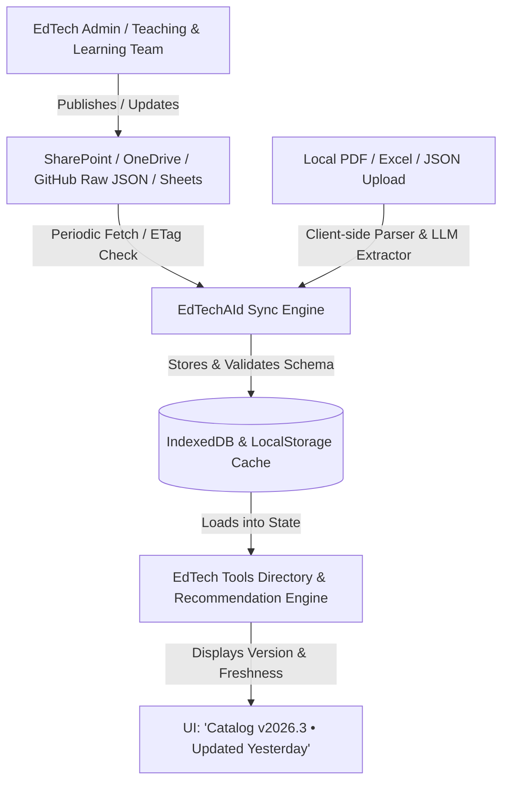

# Implementation Plan: EdTechAId Strategic & UI/UX Enhancements

This implementation plan provides a comprehensive architectural and design strategy to resolve the four core strategic and user-experience issues identified for EdTechAId.

---

## 1. Value Proposition: EdTechAId vs. Microsoft Copilot

### The Core Differentiation Matrix

| Dimension | Microsoft Copilot (General Enterprise AI) | EdTechAId (Specialized Pedagogical & Institutional Advisor) |
| :--- | :--- | :--- |
| **Institutional Grounding** | Generic public knowledge; unaware of Singapore Institute of Technology (SIT) software licensing, procurement status, IT security, or bespoke tools. | **Deep SIT institutional alignment**: Directly catalogs and maps the 29 SIT-approved EdTech tools, bespoke internal applications (AI-Buddy, AI-ORATE), and authorized xSiTe/Canvas LMS integrations. |
| **Pedagogical Frameworks** | Produces generic bullet points or broad lesson plans without pedagogical scaffolding. | **Rigorous Educational Engineering**: Systematically maps to **8 Pedagogical Categories**, **Bloom’s Revised Taxonomy**, and **SAMR Model tiers** directly tied to module Learning Outcomes (LOs). |
| **Syllabus & Curriculum Context** | Requires users to manually write extensive prompts and explain educational constraints. | **Automated Module Profile Extraction**: Ingests SIT syllabus documents/PDFs, auto-extracts weekly schedules, assessment modes, cohort sizes, and diagnostic challenges. |
| **Support & Governance Actionability** | Recommends random commercial third-party SaaS tools that may violate university PDPA, cost student money, or lack institutional support. | **Actionable Internal Pathways**: Links instructors directly to SIT Teaching & Learning / EdTech specialists (e.g., Li Siong, Mun Hin) with pre-filled inquiry templates and pilot workflows. |
| **Multi-Agent Advisory Architecture** | Single, broad LLM conversational interface. | **4-tier pedagogical pipeline**: Pedagogical Intent Analyst → Activity & Scaffold Architect → Institutional Matchmaker → Rubric & Timeline Synthesizer. |

### Implementation Deliverables for Value Proposition:
1. **Institutional Comparison & Value Anchor**: Embed a subtle "Why EdTechAId vs Generic AI" banner / modal in the UI to orient faculty on institutional benefits (FERPA/PDPA compliant, SIT-licensed, support-backed).
2. **Pedagogical Governance Badge**: Visually demarcate institutional support tier on every recommendation (e.g., `🏛️ SIT Bespoke`, `🏢 SIT Enterprise License`, `✅ SIT Supported`).

---

## 2. Continuous Updating Mechanism for Reference Files & EdTech Tools

### Problem
Currently, the 29 SIT EdTech tools are hardcoded in `app.js` (`SIT_EDTECH_TOOLS`), and reference files/syllabi are manually uploaded into volatile browser memory. When new tools are procured, existing tools updated, or institutional policies refreshed, code modifications are required.

### Proposed Architecture: Hybrid Cloud/Sync & Dynamic Ingestion



### Technical Solution Components:
1. **Separation of Data from Code**:
   - Extract `SIT_EDTECH_TOOLS` from [app.js](file:///c:/Users/T104379/OneDrive%20-%20Singapore%20Institute%20Of%20Technology/Documents/TechAId2-experiment/app.js) into an externalized, standardized JSON catalog schema: `edtech_tools_catalog.json`.
2. **Dual-Tier Sync System**:
   - **Remote Live Endpoint with Fallback**: On load, EdTechAId checks an institutional URL (or GitHub raw JSON / University SharePoint webhook) using `ETag` / `Last-Modified`. If newer, it updates client-side `IndexedDB` storage; if offline, it falls back to the local cached version.
   - **Administrative In-App Catalog Manager**: A password/role-guarded or admin modal allowing EdTech specialists to upload an updated PDF or JSON directly in the browser:
     - Includes a schema validator checking required fields (`id`, `name`, `categoryGroup`, `useCasesGeneral`, `contactInfo`, `isBespoke`).
     - Includes a visual diff review before committing the new catalog to browser/local persistence.
3. **Persistent Catalog Version Badge**:
   - Display a catalog status indicator in the header: e.g., `📅 SIT Catalog: Updated April 2026 (29 Tools)` with a quick "Check for updates" or "Import Catalog" action.

---

## 3. From Simple Reviews to Curated Pedagogical Success Stories

### Problem
Generic ratings (e.g. 4.5 stars) and superficial reviews ("Worked well for my class") fail to give higher-education instructors confidence in adopting unfamiliar tools. Instructors need contextualized evidence of efficacy.

### Proposed Architecture: The Pedagogical Case Vignette Framework
Transform user feedback into structured **Curated Success Stories** based on the **STAR-P Framework** (Situation, Task/Pedagogical Challenge, Action/Implementation, Result/Outcome, Pedagogical Takeaway):

#### Success Story Schema
```typescript
interface CuratedSuccessStory {
  id: string;
  toolId: number;
  toolName: string;
  instructorName: string;
  academicCluster: "Engineering" | "Health & Social Sciences" | "ICT" | "Business" | "Design";
  moduleCode: string;
  moduleName: string;
  cohortSize: number; // e.g. 120 students
  pedagogicalIntent: string; // e.g., "Personalised Mastery & AI-led Tutoring"
  challengeFaced: string; // "Students struggled with clinical diagnostic reasoning before OSCEs"
  implementationApproach: string; // "Embedded Socratic AI chatbot in weeks 3-5 for guided practice"
  learningOutcomesAchieved: string[]; // ["18% increase in diagnostic accuracy", "Zero grading backlog"]
  instructorQuote: string;
  verifiedByEdTechTeam: boolean; // Institutional trust badge
  resourcesShared?: { title: string; url: string }[]; // e.g., "Prompt Template", "Rubric PDF"
}
```

### UI Implementation:
1. **Interactive "Success Stories" Tab / Modal**:
   - Each tool card features a pill button: `⭐ 2 SIT Case Studies`.
   - Clicking opens an authentic case study card showing:
     - Academic cluster tag and class size.
     - Before & After metrics (e.g., student engagement, time saved, grading rubric compliance).
     - Instructor contact for peer-to-peer inquiry.
2. **Curated Submission Drawer**:
   - Instructors can submit their own teaching experiences through a structured 4-step wizard instead of a freeform text box: (1. Module & Cohort -> 2. The Problem -> 3. How Tool Was Used -> 4. What Was Achieved).
   - Submissions can be flagged as "Pending Verification" until reviewed by the EdTech unit.

---

## 4. "Less is More": Cognitive Load Reduction via Progressive Disclosure

### Problem Analysis of Current Recommendation Cards
The current card in [app.js:7440-7581](file:///c:/Users/T104379/OneDrive%20-%20Singapore%20Institute%20Of%20Technology/Documents/TechAId2-experiment/app.js#L7440-L7581) displays up to **11 visual sections at once**:
1. Checkbox and compare button
2. Title, trust badge, category pill, match %
3. 4 large suitability metric boxes (Goal, Effort, Framework, Setting)
4. Full narrative explanation box ("Why this is suitable...")
5. LO alignment badge
6. Key capabilities list (3 bullet points)
7. Contact & email box
8. Tags row
9. 8-button action toolbar

When 5 recommendations are displayed, faculty face overwhelming visual density and text fatigue.

### Solution: 2-Tier Progressive Disclosure Architecture

```mermaid
graph TD
    subgraph Tier 1: Scannable Compact Card (Default View)
        A[Tool Icon & Name] --> B[Institutional Trust Pill & Match %]
        B --> C[1-Sentence Punchy Value Hook]
        C --> D[Micro-Metric Badges: Effort ⚡ | Bloom's 📐 | Case Study ⭐]
        D --> E[Primary Action: 'Add to Plan' + 'View Details ▾']
    end

    subgraph Tier 2: Expanded Pedagogical Blueprint (On Click)
        E -->|Expands Smoothly| F[Detailed 'Why This Fits' Rationale]
        F --> G[Curated Success Stories & Outcomes]
        G --> H[Implementation Scaffolds & Capabilities]
        H --> I[Contact Specialist & LMS Integration Info]
        I --> J[Full Action Toolbar: Compare, Save, Email, Export]
    end
```

### Detailed Visual Redesign Specifications:

#### A. Scannable Compact State (Under 110px height):
- **Header**: Large clean icon + Tool name + Match pill (`🎯 95% Match`) + Institutional badge (`SIT Enterprise`).
- **One-Liner Hook**: A single concise AI summary sentence explaining the immediate pedagogical value (e.g. *"Automates clinical reasoning practice with Socratic feedback before live labs"*).
- **At-A-Glance Micro Chips**:
  - `⚡ 15-min Setup`
  - `🧠 Bloom's: Analyze`
  - `⭐ 2 Success Stories`
- **Actions**:
  - Primary button: `Quick Select` or `Explore`
  - Minimal toggle button: `Details ▾` (or click anywhere on the card header to expand)
  - Quick bookmark star icon

#### B. Expanded State (Progressive Disclosure):
- Animated accordion expansion revealing:
  - **Why It Fits My Class**: The contextual explanation tied to the instructor's selected syllabus/intents.
  - **SIT Success Stories**: Tabbed or highlighted case vignettes.
  - **Capabilities & Prerequisites**: Targeted features.
  - **Contact & Support Lead**: Li Siong / Mun Hin contact links with pre-filled email templates.
  - **Secondary Toolbars**: Compare, Discard, Copy, AI Chatbot integration.

#### C. Grid Density Controls:
- Provide a persistent toggle at the top of the recommendations grid:
  - `[ ☵ Compact View ]` (Default: high-level comparison)
  - `[ ☲ Detailed View ]` (Expands all cards simultaneously for in-depth evaluation)

---

## User Review Required

> [!IMPORTANT]
> **Key Decisions to Confirm Before Execution:**
> 1. **Catalog Storage Target**: Should the externalized catalog live as a standalone JSON file in the project directory (`edtech_tools_catalog.json`) that can be updated via a local file drop/upload modal, or should we prepare an API/SharePoint connector?
> 2. **Success Story Data Source**: Would you like an initial set of 4–6 authentic SIT case vignettes (e.g., AI Buddy in Occupational Therapy, AI-ORATE in Pharmaceutical Engineering, Miro Assist in Design) pre-populated in the catalog?
> 3. **Default Card Density**: Should the initial recommendation view load in the **Compact View** by default, with an "Expand All" toggle?

---

## Proposed Changes by Component

### Component 1: Data Architecture & Catalog Management
#### [NEW] [edtech_tools_catalog.json](file:///c:/Users/T104379/OneDrive%20-%20Singapore%20Institute%20Of%20Technology/Documents/TechAId2-experiment/edtech_tools_catalog.json)
- Standalone JSON data file containing the 29 SIT EdTech tools with extended schema:
  - `successStories`: Array of authentic case studies.
  - `conciseHook`: One-sentence value proposition.
  - `metadata`: Catalog version (`2026.3`), last updated date, and institutional maintainer contact.

#### [MODIFY] [app.js](file:///c:/Users/T104379/OneDrive%20-%20Singapore%20Institute%20Of%20Technology/Documents/TechAId2-experiment/app.js)
- Implement `CatalogManager` module:
  - Ingests `edtech_tools_catalog.json` with fallback to embedded defaults.
  - Caches to `localStorage` / `IndexedDB`.
  - Exposes `importUpdatedCatalog(file)` to allow updating the tools database anytime without touching code.
  - Exposes `checkCatalogFreshness()`.

---

### Component 2: Curated Success Stories Feature
#### [MODIFY] [app.js](file:///c:/Users/T104379/OneDrive%20-%20Singapore%20Institute%20Of%20Technology/Documents/TechAId2-experiment/app.js)
- Implement `renderSuccessStoriesModal(toolId)` and `renderSuccessStoryCard(story)`.
- Add "Submit Your Success Story" modal form with structured STAR-P fields.
- Link case studies directly into tool recommendation cards.

#### [MODIFY] [index.html](file:///c:/Users/T104379/OneDrive%20-%20Singapore%20Institute%20Of%20Technology/Documents/TechAId2-experiment/index.html)
- Add modal container for `modal-success-stories` and `modal-submit-story`.
- Add catalog update admin/manager trigger in the header or directory modal.

---

### Component 3: "Less is More" Recommendation Cards (UI/UX)
#### [MODIFY] [app.js](file:///c:/Users/T104379/OneDrive%20-%20Singapore%20Institute%20Of%20Technology/Documents/TechAId2-experiment/app.js)
- Refactor `renderToolCardHTML(tool, instructor)` to use the two-tier progressive disclosure model:
  - Render sleek, compact summary card by default.
  - Collapsible `<div class="tool-card-expanded-details">` toggled via `toggleToolCardExpansion(toolId)`.
  - Add view switcher bar: `Compact View` vs `Detailed View`.
- Integrate micro-metric badges (effort, framework, success story count).

#### [MODIFY] [style.css](file:///c:/Users/T104379/OneDrive%20-%20Singapore%20Institute%20Of%20Technology/Documents/TechAId2-experiment/style.css)
- Add CSS styles for:
  - Compact card layout with clean typography, micro-badges, and hover interactions.
  - Smooth height transition animations for expandable accordion panels.
  - Density toggle switch in the recommendation header.
  - Success story modal cards with cluster tags and outcome metrics.

---

## 5. 4-Pillar Pedagogical Recommendation Engine (4 × 25% = 100%) with Unbiased Evidence Triangulation

### Overview
Transforms the recommendation scoring model into a balanced, 4-pillar curriculum alignment engine that evaluates every tool across the four primary components of an academic syllabus:

$$\mathbf{\text{Total Suitability Score (100 pts / 100\%)}} = S_{\text{Desc}} (25) + S_{\text{LO}} (25) + S_{\text{Topics}} (25) + S_{\text{Act}} (25)$$

### The 5-Step Recommendation Workflow

```
[ Step 1: Extract Key Concepts from Profile ]
   ├── Descriptor: Course scope, main teaching contexts, educational purposes, intended assessment
   ├── Outcomes: Bloom's Revised Taxonomy action verbs & competencies
   ├── Topics: Weekly subjects, technical methods, conceptual keywords
   └── Activities: Delivery formats (Lectorials, Labs, Tutorials, TBL, Workshops)
              │
              ▼
[ Step 2: Multi-Field Matching Engine (4 × 25% = 100%) ]
   ├── Pillar 1 (25%): Descriptor Fit – Main Teaching Context & Purpose
   │     └── Module Descriptor ⟷ Tool Contexts & Purposes (Weighted Semantic Match +3, +2, +1, +0)
   ├── Pillar 2 (25%): Learning Outcomes Fit (Bloom's Taxonomy + Target Competencies)
   ├── Pillar 3 (25%): Topics Covered Fit (Domain Methods + Technical Subject Matter)
   └── Pillar 4 (25%): Learning Activities Fit (Scheduled Delivery Archetypes)
              │
              ▼
[ Step 3: Objective Evidence Triangulation (Unbiased Option A) ]
   ├── 1. Direct Task Affordance (Core native feature directly fulfills syllabus task)
   ├── 2. Cognitive Modality Proof (Verifiable Bloom's cognitive ceiling alignment)
   └── 3. Verified Capability Convergence (Balanced cross-check of useCasesGeneral & useCasesSIT)
              │
              ▼
[ Step 4: Generate 4-Part Structured Rationale ]
   ├── 💡 Why Suitable (cross-pillar alignment justification)
   ├── 🚀 Recommended Use (concrete deployment in scheduled session)
   ├── 🎯 Strongest Evidence (triangulated functional affordance citation)
   └── 📌 Relevant LO / Assessment (direct link to intended learning outcome)
              │
              ▼
[ Step 5: Rank & Shortlist Tools ]
   ├── Curated Shortlist (Top 5) and All Evaluated Tools sorted strictly by Total Score (0–100 pts)
   └── Display transparent 4-pillar breakdown in the Scoring Calculation modal
```

### Detailed Scoring Breakdown

#### 1. Pillar 1: Descriptor Fit – Main Teaching Context & Purpose (Score Percentage)
- **Authentic Raw Teaching Contexts (Extracted Directly from the Module Descriptor)**: 
  - Instead of forcing the syllabus into rigid, predefined generic labels (e.g. *"Collaborative & Team-Based Learning"*, *"Reflective Learning & Metacognitive Development"*), the system extracts the **actual raw teaching contexts and phrasing directly and specifically from the Module Descriptor text**.
  - The extracted contexts reflect the authentic disciplinary situations, professional practices, and educational purposes stated in the descriptor (e.g., *"Collaborative team goal-setting"*, *"Clinical reasoning skills to evaluate diagnostic cases"*, *"Assessment using defined performance criteria"*, *"Critical reflection of practice"*).
  - This ensures a strict and clean boundary: **Pillar 1 focuses purely on the Module Descriptor**, while Pillar 2 focuses on Learning Outcomes, Pillar 3 on Topics Covered, and Pillar 4 on Learning Activities.
- **Identical Canonical Context Evaluation Across All Tools**:
  - The extracted teaching contexts from the uploaded module profile are established once as the unified canonical list for that syllabus.
  - Every single tool (across both local repository evaluation and live Gemini AI recommendations) is evaluated against this **exact same set of extracted teaching contexts in the same order**.
  - This guarantees a uniform maximum possible raw score ($N_{\text{contexts}} \times 3$) across all tools, complete mathematical consistency (no erroneous fractions), and direct comparability across tools.
- **Semantic Synonym Grouping**: Concepts expressed with different phrasing that share an underlying pedagogical purpose are grouped into a single cohesive context and counted **only once** (e.g. *"assessment using defined performance criteria"* and *"structured evaluation against criteria"* are deduplicated into a single teaching context).
- **Weighted Semantic-Match Scoring**:
  | Match Level | Description | Points |
  | :--- | :--- | :---: |
  | **Strong match** | Tool directly supports the same main teaching context/purpose described in the module (e.g., Nudgyt or TimelyGrader for rubric-based assessment) | **+3** |
  | **Related match** | Tool supports a closely related teaching context/purpose | **+2** |
  | **Partial match** | Tool has an indirect but relevant connection to the teaching context/purpose | **+1** |
  | **No meaningful match** | No relevant teaching-context/purpose relationship | **+0** |
- **Score Percentage Formula (Pure Logical Percentage)**:
  $$\mathbf{\text{Score Percentage}} = \left( \frac{\text{Raw Score}}{\text{Maximum Score}} \right) \times 100\%$$
  - $\text{Raw Score} = \sum \text{Points earned across all authentic raw teaching contexts}$
  - $\text{Maximum Score} = N_{\text{contexts}} \times 3$
  - The UI **deletes the legacy "+XX / 25 pts" display** in favor of the clean, intuitive **Score Percentage** (e.g. `83% (10 / 12 raw pts)`).
  - Its 25% weighted contribution to the total 100-point curriculum fit score is calculated as $\text{Score Percentage} \times 0.25$.
- **UI Label**: Displayed as **“Descriptor Fit – Contexts & Points (Score Percentage = Raw / Max × 100%)”** with the authentic raw contexts, individual points earned, and overall score percentage.

#### 2. Pillar 2: Learning Outcomes Fit – Competencies & Bloom Alignment (Score Percentage)
- **Strict Isolation to Learning Outcomes Text (Zero Cross-Pillar Mixing)**:
  - Tools are evaluated **strictly and exclusively against the uploaded/extracted Learning Outcomes statements**.
  - Does **not** mix in Module Descriptor (Pillar 1), Topics Covered (Pillar 3), or Learning Activities (Pillar 4).
- **Identical Canonical Outcomes Evaluation Across All Tools**:
  - Every single tool (across both local evaluation and live Gemini AI recommendations) is evaluated against the **exact same set of authentic Learning Outcomes in the same order**.
  - Guarantees an identical maximum possible raw score ($N_{\text{outcomes}} \times 3$) across all tools.
- **Weighted Semantic & Cognitive Match Scoring**:
  | Match Level | Description | Points |
  | :--- | :--- | :---: |
  | **Strong match** | Tool directly enables and assesses the cognitive action verb (e.g. *Apply*, *Evaluate*, *Design*) and disciplinary competency demanded by this specific Learning Outcome | **+3** |
  | **Related match** | Tool supports an adjacent or scaffolded cognitive tier / competency of this Learning Outcome | **+2** |
  | **Partial match** | Tool provides indirect or auxiliary support for this Learning Outcome | **+1** |
  | **No match** | Tool does not address or facilitate this Learning Outcome | **+0** |
- **Score Percentage Formula (Pure Logical Percentage)**:
  $$\mathbf{\text{Outcomes Fit Score Percentage}} = \left( \frac{\text{Raw Score}}{\text{Maximum Score}} \right) \times 100\%$$
  - $\text{Raw Score} = \sum \text{Points earned across all canonical Learning Outcomes}$
  - $\text{Maximum Score} = N_{\text{outcomes}} \times 3$
  - Its 25% weighted contribution to the total 100-point curriculum fit score is calculated as $\text{Score Percentage} \times 0.25$ (0 to 25 pts).
- **UI Label**: Displayed as **“Learning Outcomes Fit — Outcomes & Points (Score Percentage = Raw / Max × 100%)”** with individual points earned per outcome (`LO1 (+3 pts)`, `LO2 (+2 pts)`, etc.) and the overall score percentage.

#### 3. Pillar 3: Topics Covered Fit – Disciplinary Concepts & Methods (Score Percentage)
- **Strict Isolation to Topics Covered Text (Zero Cross-Pillar Mixing)**:
  - Tools are evaluated **strictly and exclusively against the uploaded/extracted Topics Covered statements**.
  - Does **not** mix in Module Descriptor (Pillar 1), Learning Outcomes (Pillar 2), or Learning Activities (Pillar 4).
- **Identical Canonical Topics Evaluation Across All Tools**:
  - Every single tool (across both local evaluation and live Gemini AI recommendations) is evaluated against the **exact same set of authentic Topics in the same order**.
  - Guarantees an identical maximum possible raw score ($N_{\text{topics}} \times 3$) across all tools.
- **Weighted Semantic & Disciplinary Match Scoring**:
  | Match Level | Description | Points |
  | :--- | :--- | :---: |
  | **Strong match** | Tool directly provides functional features, specialized domain environments, or direct disciplinary methods for this specific topic | **+3** |
  | **Related match** | Tool supports an adjacent or foundational aspect of this topic | **+2** |
  | **Partial match** | Tool provides general instructional delivery or auxiliary presentation relevant to this topic | **+1** |
  | **No match** | Tool has no meaningful connection or capability for this topic | **+0** |
- **Score Percentage Formula (Pure Logical Percentage)**:
  $$\mathbf{\text{Topics Fit Score Percentage}} = \left( \frac{\text{Raw Score}}{\text{Maximum Score}} \right) \times 100\%$$
  - $\text{Raw Score} = \sum \text{Points earned across all canonical Topics}$
  - $\text{Maximum Score} = N_{\text{topics}} \times 3$
  - Its 25% weighted contribution to the total 100-point curriculum fit score is calculated as $\text{Score Percentage} \times 0.25$ (0 to 25 pts).
- **UI Label**: Displayed as **“Topics Covered Fit — Topics & Points (Score Percentage = Raw / Max × 100%)”** with individual points earned per topic (`Topic 1 (+3 pts)`, `Topic 2 (+2 pts)`, etc.) and the overall score percentage.

#### 4. Pillar 4: Learning Activities Fit – Scheduled Formats & Delivery (Score Percentage)
- **Strict Isolation to Learning Activities Text (Zero Cross-Pillar Mixing)**:
  - Tools are evaluated **strictly and exclusively against the uploaded/extracted Learning Activities statements**.
  - Does **not** mix in Module Descriptor (Pillar 1), Learning Outcomes (Pillar 2), or Topics Covered (Pillar 3).
- **Identical Canonical Learning Activities Evaluation Across All Tools**:
  - Every single tool (across both local evaluation and live Gemini AI recommendations) is evaluated against the **exact same set of authentic Learning Activities in the same order**.
  - Guarantees an identical maximum possible raw score ($N_{\text{activities}} \times 3$) across all tools.
- **Weighted Semantic & Delivery Mode Match Scoring**:
  | Match Level | Description | Points |
  | :--- | :--- | :---: |
  | **Strong match** | Tool directly powers the scheduled instructional format or delivery mode of this specific activity (e.g., autograder/IDE for programming labs, simulation for clinics/practicums, live interactive polling for lectorials, team voting for TBL) | **+3** |
  | **Related match** | Tool supports an adjacent or collaborative component of this activity format (e.g., collaborative whiteboards in a tutorial session, or peer review rubrics for a presentation session) | **+2** |
  | **Partial match** | Tool provides general administrative or auxiliary presentation support for this activity | **+1** |
  | **No match** | Tool has no operational relevance to this learning activity format | **+0** |
- **Score Percentage Formula (Pure Logical Percentage)**:
  $$\mathbf{\text{Activities Fit Score Percentage}} = \left( \frac{\text{Raw Score}}{\text{Maximum Score}} \right) \times 100\%$$
  - $\text{Raw Score} = \sum \text{Points earned across all canonical Learning Activities}$
  - $\text{Maximum Score} = N_{\text{activities}} \times 3$
  - Its 25% weighted contribution to the total 100-point curriculum fit score is calculated as $\text{Score Percentage} \times 0.25$ (0 to 25 pts).
- **UI Label**: Displayed as **“Learning Activities Fit — Activities & Points (Score Percentage = Raw / Max × 100%)”** with individual points earned per activity (`Activity 1 (+3 pts)`, `Activity 2 (+2 pts)`, etc.) and the overall score percentage.

### Elimination of Incumbent Bias in Step 3 (Option A)
- Evaluates evidence based on whether the tool's core features directly execute scheduled syllabus tasks and verify Bloom cognitive levels.
- All 29 catalog tools are judged on an equal playing field across `useCasesGeneral` and `useCasesSIT` without demoting newer or external tools.

